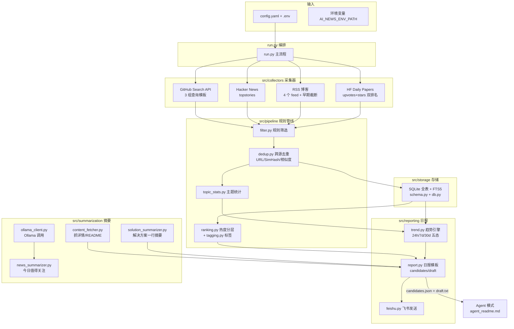

# ai-news-mvp · AI 情报采集器

轻量 AI 情报采集项目:从 **GitHub Search API / Hacker News 官方 API / 官方博客 RSS / Hugging Face Daily Papers** 四类来源采集 AI 相关情报,经**规则筛选 → 跨源去重 → 全量入库**写入 **SQLite 全表 + FTS5**,提供**规则趋势引擎**(24h/7d/30d 五态,纯规则不评分不调 LLM)与**日报**(模板 + 可选 Ollama 摘要 + Agent 模式占位符渲染 + 飞书幂等发送)。单次运行入口 `run.py`,无自建调度,由平台 autopilot 或 cron 每日触发。

技术栈:Python 3.14 + SQLite(FTS5)+ requests/httpx/feedparser/curl_cffi/simhash/trafilatura;可选本机 Ollama(`Qwen3.5:9B`)。无 torch/playwright/PostgreSQL/Redis 等重依赖。

---

## 1. 项目总体架构



**依赖方向**(从底向上):`src/core`(配置/日志/vendored 复用)被所有模块使用;`pipeline` 依赖 `storage`/`core`;`reporting` 依赖 `pipeline`/`storage`/`summarization`;`run.py` 只做编排,不实现业务逻辑。

---

## 2. 目录结构

```
ai-news-mvp/
├── run.py                    # 单次运行入口(采集/日报/发送/emit-candidates)
├── config.yaml               # 全部非秘密配置(源/关键词/阈值/超时/report/ollama/feishu)
├── .env.example              # 只列变量名,秘密只放 .env
├── requirements.txt          # 轻量依赖清单
├── agent_readme.md           # Agent 模式说明书(10 节,给 AI 编辑 agent 用)
├── doc/PROGRESS.md           # 开发进度待办(阶段 2–7 已完成)
├── scripts/
│   ├── simulate_multi_day.py # 多日连续运行模拟(8 天趋势演示)
│   └── demo_report_aiqi7.py  # 日报生成演示(排序/摘要/分段统计)
├── src/
│   ├── core/                 # 基础设施
│   │   ├── config.py         #   config.yaml + .env 加载
│   │   ├── log.py            #   按日滚动日志
│   │   └── vendor/           #   vendored ai-news-brief(MIT,© frankzch,commit 3b3e182)
│   │       ├── rss_fetcher.py / lsh_dedup.py / log_config.py
│   │       ├── content_processor.py / config_loader.py / fetch_stats.py
│   │       └── LICENSE
│   ├── collectors/           # 采集器(每个来源一个)
│   │   ├── github.py         #   GitHub Search API(3 组查询)
│   │   ├── hackernews.py     #   HN 官方 Firebase API
│   │   └── rss.py            #   RSS 博客 + HF Daily Papers
│   ├── pipeline/             # 规则管线(纯 Python,不调 LLM)
│   │   ├── filters.py        #   规则筛选(字段/时间窗/关键词,无评分)
│   │   ├── dedup.py          #   跨源去重(URL 归一化/SimHash/相似度)+ canonical_key
│   │   ├── ranking.py        #   候选排序与上榜理由(GitHub 新生代优先 + RSS/HF 热度分层)
│   │   ├── tagging.py        #   候选规则标签(平台/热度/趋势状态)
│   │   └── topic_stats.py    #   主题日统计(compute_topic_stats)
│   ├── storage/              # 存储
│   │   ├── schema.py         #   SQLite 表结构 + FTS5 + 迁移(ensure_schema)
│   │   └── db.py             #   Database 类(upsert/归并/快照/日报状态)
│   ├── summarization/        # 摘要(可选)
│   │   ├── ollama_client.py      #   Ollama /api/chat 客户端 + 输入精简
│   │   ├── news_summarizer.py    #   「今日值得关注」摘要 + 降级
│   │   ├── solution_summarizer.py#   「解决方案」一行摘要
│   │   └── content_fetcher.py    #   抓正文/README(阶段06,7 天缓存,不 clone)
│   ├── reporting/            # 日报
│   │   ├── trend.py          #   规则趋势引擎(五态)
│   │   ├── report.py         #   日报模板 + candidates/draft + 校验
│   │   └── feishu.py         #   飞书发送(幂等/脱敏/退避重试)
│   └── tools/                # 工具(阶段07)
│       ├── check_draft.py    #   draft 无 {{ 残留自检
│       └── render_draft.py   #   占位符渲染(失败兜底路径)
└── tests/                    # pytest 单元测试(146 个)
```

---

## 3. 数据来源与数据流

### 3.1 数据来源

| 来源 | 采集方式 | 每条字段 | 配置位置 |
|---|---|---|---|
| **GitHub Search API** | 3 组查询模板(新项目/新兴 Agent/活跃 LLM),`{d}` 为动态日期 | full_name/html_url/description≤200/stars/forks/created_at/pushed_at/language/topics≤5 | `config.yaml → github:` |
| **Hacker News** | 官方 Firebase API:`topstories` 前 N 条 + 规则过滤(≥`min_points` 分、年龄窗口) | title/url/points/comments/hn_id | `config.yaml → hackernews:` |
| **官方博客 RSS** | feedparser 抓取,超大 feed 早期截断(`feed_max_entries`/`feed_max_bytes`) | title/link/guid/summary/published | `config.yaml → rss.sources:`(列表可增删) |
| **Hugging Face Daily Papers** | HF Papers JSON API,按(upvotes+stars)**双排名**保留前 N 篇,只留带 GitHub 仓库的论文 | arxiv_id/upvotes/github_stars/github_repo/is_hf_papers | `config.yaml → hf_papers:` + `fetching.hf_daily_top_n` |

> 采集全部走官方 API/RSS,不绕过验证码/登录/限流/封禁;不采集视频;不接入 X/Reddit/YouTube/Bilibili。

### 3.2 数据流转图

```mermaid
flowchart LR
    subgraph 采集
        A1[GitHub 3 组查询] --> B[rule_filter 规则筛选<br/>字段完整/时间窗/关键词]
        A2[HN topstories] --> B
        A3[RSS 4 feed] --> B
        A4[HF weekly top] --> B
    end
    B --> C[Deduper 跨源去重<br/>①URL 归一化 ②标题 SimHash≤4 ③Jaccard≥0.8]
    C --> D[全量入库 upsert_item<br/>自然键 UNIQUE(platform,native_id)<br/>→ 指纹 canonical_key 7 天窗口归并<br/>→ item_sources 跨源映射]
    D --> E[project_snapshots 快照<br/>+ topic_daily_stats 主题统计]
    E --> F[trend.py 趋势引擎<br/>24h/7d/30d 五态]
    D --> G[collect_candidates 日报候选<br/>热度分层取 top-N]
    F --> G
    G --> H[report.py 日报模板<br/>六栏目 + 校验]
    G --> I[--emit-candidates<br/>candidates.json + draft.txt 占位符]
    I --> J[Agent 渲染<br/>agent_readme.md]
    H --> K[--report 存 daily_reports]
    K --> L[--send 飞书发送<br/>幂等/脱敏/退避重试]
    J --> L
```

### 3.3 每项数据如何处理

**① 采集**(`src/collectors/`):每源独立 try/except + 超时 + 退避重试,单源失败不影响其他源。GitHub 用 PAT(`GITHUB_PAT`,.env)走 search API 30/min;HN 走 Firebase 官方 API;RSS 用 vendored `rss_fetcher`(curl_cffi TLS 指纹伪装 + httpx[socks] 回退);HF 走 Papers JSON API。

**② 规则筛选**(`pipeline/filters.py`,无评分):字段完整(必须有 url+title)→ 发布时间窗口(`max_age_days`/`min_age_hours`)→ AI 关键词命中(`keywords.ai`,仅 HN/RSS/HF 判断;GitHub 由查询模板保证相关性)。不限量。

**③ 跨源去重**(`pipeline/dedup.py`):① URL 归一化(去跟踪参数/默认端口/www/尾斜杠);② 标题 SimHash 汉明距离 ≤ `dedup.simhash_threshold`(默认 4);③ 标题或摘要 token 集合 Jaccard 相似度 ≥ `dedup.similarity_threshold`(默认 0.8)判为重复。**去重后全量入库,不再入库前截断**(阶段04)。

**④ 入库与跨源归并**(`storage/db.py upsert_item`):`items` 唯一键 `UNIQUE(platform, native_id)`。各源自然键:GitHub `full_name` / HN `hn_id` / RSS `(source_id, guid)`(无 guid 回退归一化 url)/ HF `arxiv_id`(回退 url)。入库顺序:先按自然键精确匹配 → 未命中再按内容指纹 `canonical_key`(标题归一化 SimHash)近 7 天窗口模糊匹配(阈值 4)→ 命中则**合并**:新来源挂 `item_sources`,标题/摘要择优,`first_seen_at` 保留最早,不拒绝;近似标题(指纹距离 > 4)不误并。

**⑤ 趋势引擎**(`reporting/trend.py`,纯规则不评分):基于 `project_snapshots`(项目)与 `topic_daily_stats`(主题),输出五态(新出现/持续升温/突然增长/进入成熟期/热度回落),三个时间尺度 24h/7d/30d,窗口不足明确标注「窗口不足」;每个结论带证据(来源表名+数字+时间窗),禁止编造;首次运行只建基线。主题趋势每条附**代表条目(标题+url)**作为来源;GitHub 主题只取命中 AI 关键词的仓库标签,非 AI 标签(acme/backend/email 等)不污染趋势(阶段05修复)。

**⑥ 日报候选与排名**(`pipeline/ranking.py` + `reporting/report.py collect_candidates`,纯规则不评分):
- GitHub:按 `report.sort_by`(`freshness` 默认:新生代创建 ≤ `new_days` 优先,老项目仅当 24h 增量 ≥ `old_repo_min_delta_24h` 或增长率 ≥ `old_repo_min_growth_pct` 才上榜;`growth`/`stars` 可选)。
- RSS/HF 热度分层(阶段05,消费时规则不落库):层1 有真实热度(HF upvotes+stars / 跨源命中 HN 用 points)→按信号;层2 无信号但 `source_count≥2` →按重复度+新鲜度;层3 其余 →按(新鲜度,关键词权重)。
- 每条候选带 `tags`(规则标签:新项目/HN 分/HF 论文/趋势状态等)与 `score`(平台内排序指标);**不做综合评分,不跨平台合并热度**。

**⑦ 摘要**(`src/summarization/`,可选):
- **今日值得关注**(`news_summarizer.py`):只对入选 Top `highlights_cap`(8)调 Ollama(`ollama.model`,`think:false`+`format:json`+给足 `num_predict`);输入精简 JSON;输出经代码校验(项目名匹配/URL 合法/简介依据非空);**失败自动降级为规则标签**(原标题+库中事实),不阻塞、不重试。
- **解决方案一行摘要**(`solution_summarizer.py`):库中 summary → 可选抓正文首段(`report.fetch_summary: true`)→ 调 Ollama → 仍为空注明理由。
- **抓详情**(`content_fetcher.py`,阶段06):并发 4 抓候选正文;GitHub 详情来自 README(API raw → raw.githubusercontent HEAD/main/master → description+topics fallback),按 `content_hash` 缓存 7 天不重抓、**不 clone**。

**⑧ 日报模板**(`reporting/report.py`,六栏目,栏目允许为空不凑数,每条附原文链接,推测与事实分开):一、今日值得关注(2-3 条,上榜理由基于库中真实字段可解释) / 二、开源项目与工程实践(GitHub+状态标签+⭐/24h 增量) / 三、解决方案与产品发布(RSS/HF+一行摘要) / 四、趋势观察(状态+7d 证据) / 五、采集状态(发现→筛选→去重→入库 分段/模型状态/失败源) / 六、其他资讯汇总(未入选 top-N 的 RSS/HF 聚合,不丢弃)。长度与安全关键词校验(`report.max_chars`/`required_keyword`)。

### 3.4 如何扩充数据来源

**扩充已有类型(改配置即可,无需改代码):**

- **加 RSS 源**:编辑 `config.yaml → rss.sources:` 增一行 `{name, url, category}`,重启/重跑生效。
- **改 GitHub 查询**:编辑 `config.yaml → github.queries:` 增删查询模板(支持 `{d}` 动态日期),或调 `github.per_page`/`sort`/`order`。
- **调热度门槛**:`hackernews.min_points` / `min_age_hours` / `max_age_days`;`fetching.hf_daily_top_n`。
- **扩关键词**:`config.yaml → keywords.ai:` 增删词(影响 HN/RSS/HF 的筛选与主题归属)。

**新增平台类型(需改代码,以加「X 平台」为例):**

1. 在 `src/collectors/` 新建 `x.py`,实现 `XCollector.fetch()` → 返回统一条目列表,每条含:`title/url/native_id/summary/published_at/platform/category/extra/_source_url/_source_name`(参考 `github.py`/`hackernews.py`,它们已经实现统一的条目格式)。
2. 在 `run.py` 的 `main()` 采集段加一段 try/except 调用该采集器,并把条目放入 `per_platform['x']`(参考 GitHub/HN 两段)。
3. 在 `run.py` 的两处平台元组 `('github','hackernews','rss','hf_papers')`(去重循环与限量统计循环)加入 `'x'`;在 `config.yaml` 加 `x:` 配置段。
4. `reporting/report.py` 的 `collect_candidates` 加 `x` 平台的候选构建分支(热度字段/标签/排序);`reporting/report.py::_platform_display_name` 与 `run.py::_platform_level` 加平台名。
5. 加测试(`tests/`),跑 `pytest` 全绿。
6. (可选)加 `config.yaml` 的 `x.sources` 支持多子源,复用 RSS 的 `sources` 列表模式。

---

## 4. 快速开始

```bash
# 1) 准备虚拟环境并装依赖(在项目根 = 仓库根目录,即 run.py 所在处)
cd <项目根>
python3.14 -m venv --without-pip .venv        # 系统无 pip 时先引导
.venv/bin/python get-pip.py || true          # 或已有 pip 则跳过
.venv/bin/python -m pip install -r requirements.txt

# 2) 准备秘密 .env(复制模板并填入真实值,chmod 600)
#    .env 定位:AI_NEWS_ENV_PATH 环境变量 → 项目根上两级 .env → 项目根 .env
#    部署时 .env 通常在项目根上两级目录(../../.env),运行前显式指定:
#    export AI_NEWS_ENV_PATH=$(cd ../.. && pwd)/.env
cp .env.example .env && chmod 600 .env        # 填入 GITHUB_PAT / FEISHU_WEBHOOK_URL / FEISHU_WEBHOOK_KEYWORD
```

```bash
# 3) 日常运行(重要:必须用 .venv 的 python,不要用系统 python3)
cd <项目根>
export AI_NEWS_ENV_PATH=$(cd ../.. && pwd)/.env   # 按实际 .env 位置指定

./.venv/bin/python run.py --since-days 7             # ① 仅采集(全量入库)
./.venv/bin/python run.py --report                   # ② 采集 + 生成日报存库
./.venv/bin/python run.py --send                     # ③ 从库发送当日日报(幂等,不采集)
./.venv/bin/python run.py --report --send            # ④ 采集 + 生成 + 发送一次
./.venv/bin/python run.py --report --no-summarize    # ⑤ 跳过 Ollama,强制规则模式
./.venv/bin/python run.py --emit-candidates          # ⑥ 产出 candidates.json + draft(默认开)
./.venv/bin/python run.py --no-emit-candidates       #    关闭 candidates/draft 产出
```

> ⚠️ **不要用系统 `python3 run.py`**:系统解释器未装第三方包,会 `ModuleNotFoundError`。必须用 `.venv/bin/python`(或 `source .venv/bin/activate` 后 `python3`)。

常用 flag:`--date YYYY-MM-DD`(指定运行日期)/ `--db PATH`(指定库文件)/ `--config PATH` / `--since-days N`。`--report` 与 `--send` 分离:飞书不可用时先 `--report`,恢复后直接 `--send` 重发,不重新抓取。

---

## 5. 可配置信息总结

全部非秘密配置在 `config.yaml`;秘密(`GITHUB_PAT`/`FEISHU_WEBHOOK_URL`/`FEISHU_WEBHOOK_KEYWORD`)只放 `.env`。路径用 `os.path.expandvars` 解析(支持 `$VAR` 语法),`--db` 可覆盖库路径。

### paths / app / fetching

| 配置项 | 默认 | 作用 |
|---|---|---|
| `app.since_days_default` | 7 | 默认采集窗口(`--since-days` 覆盖) |
| `paths.data_dir` | `../../data` | 数据目录(相对项目根;可含 `$VAR` 经 expandvars 解析) |
| `paths.log_dir` | `../../logs` | 日志目录 |
| `paths.db_file` | `ai_news_mvp.sqlite3` | SQLite 文件名(`--db` 覆盖) |
| `fetching.network_timeout` | 90 | vendored rss_fetcher 网络超时(秒) |
| `fetching.hf_daily_top_n` | 5 | HF 按(upvotes+stars)保留前 N 篇 |

### 各来源

| 配置项 | 默认 | 作用 |
|---|---|---|
| `github.api_base` / `per_page` | api.github.com / 30 | API 地址 / 每组每页上限(search 30/min) |
| `github.queries` | 3 组模板 | 查询模板(`{d}`=动态日期),可增删 |
| `github.per_platform_cap` | 10 | 日报候选统计口径(不影响入库) |
| `github.timeout` / `retries` / `backoff_seconds` / `request_interval_seconds` | 30/2/2/1.2 | 超时/退避重试/查询间隔 |
| `hackernews.api_base` / `top_n` | Firebase v0 / 50 | API 地址 / topstories 前 N 条 |
| `hackernews.min_points` | 100 | HN 热度阈值(score) |
| `hackernews.min_age_hours` / `max_age_days` | 2 / 3 | 年龄窗口 |
| `rss.sources` | 4 个官方博客 | feed 列表(name/url/category),**可增删** |
| `rss.max_age_days` / `feed_max_entries` / `feed_max_bytes` | 7 / 60 / 262144 | 年龄窗口 / 早期截断 |
| `hf_papers.url` / `max_age_days` | HF API / 14 | 数据源 / 年龄窗口(按周批放宽) |

### 去重 / 关键词 / 主题

| 配置项 | 默认 | 作用 |
|---|---|---|
| `dedup.simhash_threshold` | 4 | 标题 SimHash 汉明距离阈值(越小越严格) |
| `dedup.similarity_threshold` | 0.8 | Jaccard 相似度 ≥ 该值判重(≤0 关闭) |
| `keywords.ai` | 24 词 | 规则初筛关键词(仅 HN/RSS/HF) |
| `topics.max_per_item` | 3 | 每条目最多主题数(GitHub 仅保留命中 `keywords.ai` 的标签,无命中归入 opensource) |
| `limits.per_platform_cap` | 10 | 每平台每日候选上限(硬性约束) |

### trend(趋势阈值)

| 配置项 | 默认 | 作用 |
|---|---|---|
| `trend.windows.24h/7d/30d` | 2/7/30 | 各窗口最小历史天数(不足标「窗口不足」) |
| `trend.project.young_days` | 30 | 创建 ≤ 30 天 → 新项目 |
| `trend.project.sudden_growth_ratio` | 3.0 | 24h 增量 ≥ 前 7d 日均 ×3 → 突然增长 |
| `trend.project.warming_min_days` / `warming_min_growth_pct` | 3 / 0.5 | 连续正增长 → 持续升温(幅度不足标「尚待观察」) |
| `trend.project.maturity_stars` / `maturity_growth_pct` | 50000 / 0.05 | 成熟期候选 / 稳定判定 |
| `trend.project.decline_negative_days` / `stagnation_days` / `stagnation_max_delta_pct` | 2 / 7 / 0.05 | 热度回落 / 重复降权 |
| `trend.topic.*` | 2.0 / 3 / 3 / 2 | 主题五态对应阈值 |

### report(日报)

| 配置项 | 默认 | 作用 |
|---|---|---|
| `report.required_keyword` | 每日ai情报 | 飞书安全关键词(env `FEISHU_WEBHOOK_KEYWORD` 可覆盖) |
| `report.max_chars` | 6000 | 日报长度上限(超长裁剪) |
| `report.highlights_cap` / `max_highlights` | 8 / 3 | 入选 Top N / 「今日值得关注」条数 |
| `report.opensource_max` / `solutions_max` | 5 / 5 | 二/三栏目条数 |
| `report.trends_projects_max` / `trends_topics_max` | 3 / 3 | 四栏目条数 |
| `report.sort_by` | freshness | freshness(新生代优先,兼顾老项目增量)/ growth / stars |
| `report.new_days` | 30 | 新生代阈值 |
| `report.old_repo_min_delta_24h` / `old_repo_min_growth_pct` | 50 / 0.5 | 老项目上榜门槛(增量或增长率) |
| `report.recent_push_days` | 7 | 快照不足时新生代须近期 push 窗口 |
| `report.fetch_summary` / `summary_max_chars` | false / 80 | 解决方案抓正文/一行摘要长度 |

### ollama(可选摘要)/ feishu(发送)

| 配置项 | 默认 | 作用 |
|---|---|---|
| `ollama.base_url` / `model` | 192.168.0.103:11434 / Qwen3.5:9B | 服务地址 / 模型 |
| `ollama.enabled` | true | false 时强制规则模式 |
| `ollama.timeout` / `think` / `num_predict` / `temperature` | 180 / false / 2048 / 0.2 | 调用参数 |
| `ollama.min_output_items` / `max_output_items` | 3 / 5 | 输出校验上下限 |
| `ollama.agent.*` | temp 0.1 / predict 512 / ctx 4096 / penalty 1.05 / batch 4 | **Agent 模式参数**(阶段07) |
| `feishu.timeout` / `max_retries` / `backoff_seconds` | 30 / 3 / 3 | 发送超时 / 重试 / 退避 |

---

## 6. 对接飞书

1. **创建机器人**:飞书群 → 设置 → 群机器人 → 自定义机器人 → 复制 Webhook URL,并设置**安全关键词**(与 `report.required_keyword` 或 `FEISHU_WEBHOOK_KEYWORD` 一致,默认「每日ai情报」)。
2. **写 .env**(秘密,严禁提交/打印/写日志):
   ```
   FEISHU_WEBHOOK_URL=https://open.feishu.cn/open-apis/bot/v2/hook/xxxx
   FEISHU_WEBHOOK_KEYWORD=每日ai情报
   ```
3. **发送**:`run.py --report --send`(先生成日报存库,再发送)。发送逻辑见 `src/reporting/feishu.py`:
   - webhook 只从环境变量读取;所有日志/异常/`daily_reports.last_error` 都脱敏为 `<redacted>`。
   - **幂等**:当日 `sent_status='sent'` 不重复发送;只有飞书确认 `code==0` 才置 `sent`。
   - 明确失败(HTTP 非 0)→ 指数退避重试 `feishu.max_retries` 次;结果不确定(超时/响应无法解析)→ 置 `uncertain` 停止重发。
   - 发送文本必须含安全关键词,缺失拒绝发送。
4. **失败恢复**:飞书不可达时日报仍在 `daily_reports`(sent_status=failed),恢复后 `run.py --send --date YYYY-MM-DD` 从库重发,不重新采集。

---

## 7. 定时任务执行

本项目**无自建调度**,每日触发方式二选一(或并用):

### 方式 A:平台 autopilot(推荐)

```bash
# 1) 建 autopilot(采集或采集+发送)
multica autopilot create \
  --title "每日AI情报-采集" \
  --description "<任务提示词:cd <项目根> && ./.venv/bin/python run.py --since-days 7 ...>" \
  --agent <agent名或ID> \
  --mode create_issue \
  --issue-title-template "每日AI情报 采集 {{date}}" \
  --project <project-id>        # 可选

# 2) 加定时触发(必须显式 --timezone,否则默认 UTC 会偏 8 小时)
multica autopilot trigger-add <autopilot-id> \
  --kind schedule --cron "30 21 * * *" --timezone Asia/Shanghai --label "每日 21:30 采集"

# 3) 查看/验证
multica autopilot list
multica autopilot get <autopilot-id>
multica autopilot runs <autopilot-id>
```

建议节奏:先采集后发送(如 21:30 采集、21:45 发送),发送用 `run.py --report --send --date $(date +%Y-%m-%d)`。

### 方式 B:本地 cron

```bash
crontab -e
# 每天 08:00 全链路(采集+生成+发送);<项目根> 为仓库根目录(含 run.py)
0 8 * * * cd <项目根> && export AI_NEWS_ENV_PATH=$(cd ../.. && pwd)/.env && <项目根>/.venv/bin/python run.py --since-days 7 --report --send >> <项目根>/../../logs/cron.log 2>&1
# 或拆分两步:21:30 采集,21:45 生成并发送
30 21 * * * cd <项目根> && export AI_NEWS_ENV_PATH=$(cd ../.. && pwd)/.env && <项目根>/.venv/bin/python run.py --since-days 7 >> <项目根>/../../logs/cron.log 2>&1
45 21 * * * cd <项目根> && export AI_NEWS_ENV_PATH=$(cd ../.. && pwd)/.env && <项目根>/.venv/bin/python run.py --report --send --date $(date +\%Y-\%m-\%d) >> <项目根>/../../logs/cron.log 2>&1
```

日志按日滚动,保留 90 天;程序幂等,重复跑安全。

---

## 8. Agent 模式(阶段06/07,可选)

`run.py --emit-candidates`(默认开)产出两份文件供 AI 情报编辑 agent 使用:

- `data/ai_news_mvp_candidates_YYYYMMDD.json` — 候选条目(`placeholder/url/title/platform/facts/reason/content/content_source/fallback_intro` + `stats/trends`);
- `data/ai_news_mvp_draft_YYYYMMDD.txt` — 带 `{{INTRO_Hx/Ox/Sx}}/{{MODEL_STATUS}}` 唯一占位符的草稿。

agent 按 **`agent_readme.md`** 的说明分批(≤4 条)调用本机 Ollama(`ollama.agent.*` 参数)替换占位符;失败兜底:content 空→`fallback_intro`,非 JSON/条数不匹配→重试 1 次仍失败整批 fallback;飞书 `code!=0` 停止、超时不重发。

自检(可选):

```bash
./.venv/bin/python -m src.tools.check_draft data/ai_news_mvp_draft_YYYYMMDD.txt --report data/ai_news_mvp_candidates_YYYYMMDD.json
./.venv/bin/python -m src.tools.render_draft data/ai_news_mvp_draft_YYYYMMDD.txt data/ai_news_mvp_candidates_YYYYMMDD.json -o out.txt
```

`--report --send` 降级路径(脚本规则生成 + 飞书发送)保留可用。

---

## 9. 运行产物

- SQLite:`data/ai_news_mvp.sqlite3`(相对 data_dir),含 `sources/items/item_sources/project_snapshots/topic_daily_stats/runs/daily_reports/items_fts`;旧库自动迁移(FTS rebuild)。
- 运行统计 JSON:`data/ai_news_mvp_run_YYYYMMDD.json`(来源统计/趋势/日报/emit 结果,当日覆盖)。
- 日志:`logs/ai_news_mvp_YYYY-MM-DD.log`,按日滚动,保留 90 天。
- candidates/draft:`data/ai_news_mvp_candidates_YYYYMMDD.json` + `data/ai_news_mvp_draft_YYYYMMDD.txt`(Agent 模式)。
- 内容缓存:`data/content_cache.json`(GitHub README,7 天不重抓)。

**退出码与 runs 状态**:退出 0 = 至少一个来源成功且有去重后条目(即使部分源失败);1 = 全部失败/无条目/日报生成或发送失败。`runs.status` = `ok` / `partial` / `failed`。错误按来源写进 `runs.errors` 与 `sources.last_error`。

---

## 10. 测试与故障恢复

```bash
./.venv/bin/python -m pytest tests/ -q   # 全量测试,当前 146 个
./.venv/bin/python scripts/simulate_multi_day.py   # 多日趋势演示
./.venv/bin/python scripts/demo_report_aiqi7.py    # 日报质量演示
```

覆盖:趋势五态、快照幂等、FTS5 同步、旧库迁移、跨源归并、主题统计、日报模板/校验、Ollama 降级、飞书幂等/退避、run.py 断网与单源失败、日志滚动、热度分层、candidates/draft、agent 工具。

**故障恢复**:

| 故障 | 表现与处理 |
|---|---|
| 断网/全源失败 | 不崩溃,退出 1,`runs.status=failed`,每源错误入库;恢复后重跑(幂等) |
| 单源失败 | 其余源照常,`partial`,退出 0 |
| Ollama 不可达 | 日报自动降级为规则标签,不阻塞、不重试 |
| 飞书不可达 | 日报已存库,恢复后 `--send --date` 从库重发;已 `sent` 不重发 |
| 发送超时/结果不确定 | 置 `uncertain` 停止重发,避免重复推送 |
| GitHub 限流 403/429 | 不硬闯,记录并跳过该查询 |
| 想重置库 | 删 `data/ai_news_mvp.sqlite3` 后重跑(自动建表) |

---

## 11. 依赖与约束

- **复用来源**:[frankzch/ai-news-brief](https://github.com/frankzch/ai-news-brief)(MIT,commit `3b3e182`)的 `rss_fetcher`/`lsh_dedup`/`log_config`/`content_processor` 已 vendoring 到 `src/core/vendor/`(保留版权头与 LICENSE);**仓库自包含**,不依赖外部 `ai-news-brief` 目录。
- **Python**:开发环境实测 3.14.4;`requirements.txt` 为下限约束。
- **依赖**:`requests`、`httpx[socks]`、`feedparser`、`curl_cffi`、`simhash`、`pyyaml`、`python-dotenv`、`beautifulsoup4`、`trafilatura`。
- **约束**:不安装 torch/playwright/psycopg2/PostgreSQL;不引入 Redis/Kafka/向量库/复杂多智能体;模型调用可选(默认规则优先)。
