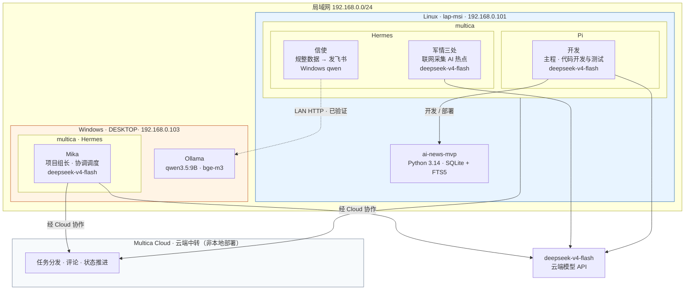

# Multica 跨电脑协作开发复盘：多智能体工作流开发一个AI 情报日报

这次实践最值得总结的，是复牌这套跨设备、多智能体、云端与本地模型混合、代码与自动化分离的开发架构。
记录一次多agent协作的探索

代码仓库为  https://github.com/GigaEphemeral/ai_news_collector  
功能上是还有很多缺陷和不足的，大家可以自己拿去调整测试随便改
如果需要也自己试试这样一套架构的话， 我整理一份prd文档放在  prddoc下， 可以试试测试不同agent的表现， 找到最速最省的方案， 期待同仁的测试. 
## 项目目标和成果
**总体目标**： 一次对multica-ai 在跨设备/多智能体协作方向的测试， 实现个人流水线的优化和探索。 
	-- 关于multica-ai :  *https://multica.ai/*   可以先看官方使用案例文档    *https://multica.ai/docs/zh/tutorial* 
**项目缘由**：   
    之前使用的deepseek harness， 但是我常用的只有一台windows笔记本， 基本上所有数据都在这台笔记本上， 在使用dsh给dsh开发插件的时候受尽了折磨. 
    <br> 什么windows下的gbk编码， xml的BOM头， 各种windows powershell / gitbash 的命令行问题， 导致开发过程中产生了大量的循环工具调用。 最恐怖的一次是出现powershell的一个报错之后， 之前使用的dsh 0.1.2版本， 在疯狂循环重复错误，给我5小时限制烧完了， 还没创建出有价值的东西. 
	本想着使用WSL配置算了， 回头想到家里还有个老笔记本， 就在老笔记本上直接安装ubuntu， 顺便探索下跨电脑多agent协作。 以后如果每个开发都有个人的agent，这样的协作探索或许也是一个不错的方向。 

**开发目标**： 实现一个自动化采集ai热点和热门ai仓库的自动化任务，每天总结之后通过飞书机器人发送
**环境架构**：
电脑结构如下， 
个人电脑为 windows， 32G内存 4060 8G, 勉强跑 qwen3.5:9B
另一台是 ubuntu， 16G 1050Ti
两台都部署了multica-ai， hermes , pi, dsh
当前dsh和multica的集成比较差， multica还无法识别到



以上的部署结构里面 multica之间的通信是使用的他们的服务器， 在官方文档里面有说明， 可以做本地化部署，docker启动， 不过这样服务端的效率问题， 就需要自己维护优化了。 


**开发成果展示**： 

## 项目开发历程概要
由我和gpt网页版先进行沟通， 获取项目需求发散和架构设计 

2026 年 10 月 14 日 18:48 开始由ai进行开发，到22点40左右完成所有阶段开发， 和几个小问题优化； 
到 10 月 15 日 08:53 完成首个自动日报周期；
agent的核心开发时间为**4个半小时**

集中在当晚约 4.2 小时。系统使用 Python、SQLite 和 FTS5 实现采集、筛选、去重、趋势分析、日报生成及飞书发送；Multica 负责协调开发任务和定时触发，多个 Hermes/Pi 智能体承担不同工作。
### token消耗在 multica的记录下如下图： 

### 真正扣钱平台的token统计
总用量：（14这天其他几乎没咋用，可以近似看作是全部消耗在这里） 


## 总体评价：
这是一套有效的个人 AI 开发工作流原型，但还不是完全成熟的多智能体生产体系。
它的主要优势是分工灵活可视；  **模型成本和开发速度上， 并不占优势**。
主要短板是跨任务上下文重读、执行权限边界、运行状态可观测性，以及多套自动化之间的职责容易重叠。

multica目前我使用下来最大的问题是  任务 的机制， 如下图所示的任务页面。 
1.多个分阶段的开发任务， “纯开发” 这个角色在执行不同任务的时候， 是丢失上下文的，需要重新读代码， 重新读任务
速度会慢和token消耗会上去； 好处是记忆比较纯洁。 但是这玩意儿见仁见智， 主要还是看自己的需求吧
2. 多任务并行时候的锁问题， 如果有多个agent都要处理一个目录和文件， multica采取的是上锁， 等待的处理方式，也是导致速度大大下降，不过安全倒是安全


为什么这么慢我这边就没有细致排查了，大致思路在以下几个地方

| 现象         | 优先怀疑的原因             | 怎么判断              |
| -------------- | ------------------- | ----------------- |
| 任务一直显示 Queued  | 运行时领取任务、并发限制、网络连接   | 查看任务状态和 daemon 状态 |
| 已开始执行，但长时间没有输出 | 模型服务响应、CLI 启动、技能加载  | 看执行日志停在哪一步        |
| 输出持续生成，但每一步都很慢 | 模型推理速度、上下文长度、工具调用次数 | 用同一模型做简单任务对比      |

官方还专门记录过会话加载缓慢的问题，以及任务耗时缺少阶段级诊断信息的问题。[会话加载性能问题](https://github.com/multica-ai/multica/issues/109) · [任务阶段耗时诊断需求](https://github.com/multica-ai/multica/issues/6859)。


以下是详细记录复盘

## 一、跨电脑开发环境与智能体分工
### 1. 设备分工

Linux 笔记本：主开发机与生产运行环境， 存放正式项目、虚拟环境、`.env`、数据库、日报数据和日志。作为项目的唯一权威运行环境。
		
		 Ubuntu 26.04.1 · Python 3.14 · Git · SQLite

Windows 笔记本：开发辅助台与本地模型宿主， 提供 Qwen3.5:9B、bge-m3 等本地模型服务。Linux 可以通过局域网调用 Ollama，降低云端模型调用成本。

	Windows 10 · 32GB 内存 · RTX 4060 8GB · Ollama

Multica：任务组织与智能体协作入口， 把项目拆成 Issue，分配开发、采集、发送等任务，并通过自动化安排周期性工作。它是协作与编排层，不应该成为每天必须参与思考的“超级主程序”。

这套布局的核心原则是：代码和数据归 Linux 管，模型推理由合适的云端或本地模型承担，Multica 管理任务和流程。

跨电脑不意味着每台机器都维护一份独立的正式代码。正式代码应通过 Git 同步；数据库、凭证和运行状态则需要单独制定规则，仅靠代码仓库同步。

### 2. 五个智能体的角色设计

| 智能体    | 运行环境 / 模型     | 主要职责                            | 评价                          |
| ------ | ------------- | ------------------------------- | --------------------------- |
| Mika   |  DeepSeek v4f + hermes        | Chief of Staff、任务拆分、Issue 协调与验收 | 适合做项目调度入口                   |
| 纯开发    |  DeepSeek v4f + pi   | 编码、测试、修复、文档                     | 开发能力集中，但也是主要云端 token 消耗者    |
| 军情三处   | DeepSeek v4f + hermes  | 联网搜索 AI 热点                      | 适合搜索型任务，但应约束搜索范围和输出格式       |
| 信使     | 本地 Qwen3.5:9B | 数据规整、生成或整理日报、飞书发送               | 可减少云端 token，但复杂文本整理质量需要实测   |
| 本地数据分析 | 本地 Qwen3.5:9B | 本地分析、开发辅助                       | 有成本优势；不必为了“有一个分析智能体”而安排常驻任务 |

没钱啊， 有钱就上更牛批的api了

这里有一个值得坚持的架构判断：智能体数量不等于系统能力。 每个智能体都应该对应清晰的输入、输出和权限。如果某项工作用一个 Python 函数就能可靠完成，就没有必要每次都启动一个需要消耗上下文的智能体。

尤其是本地数据分析智能体：它目前有明确的“本地分析”定位，可以保留为按需工具，不必进入每天的关键链路。

## 二、这次项目是怎样完成的

忽略整套部署的时间成本， 从项目开始构思开始. 先和chatgpt 聊天确认项目结构采用的技术方案， 形成完整的PRD文档，然后直接丢给mika开始分析和准备开发.


分析结束之后他会帮你创建任务开始执行， 要做的就是出现卡点的时候进行确认， 在一个任务结束之后进行审核


## 23 分钟

AIQI-1

阶段 1：审计与最小可行版

审计已有的 `ai-news-brief` 项目，确认可复用的模块和运行限制，而不是直接把原项目整体搬过来。

## 57 分钟

AIQI-3

阶段 2：接入情报源

接入 GitHub Search API、Hacker News 官方 API、RSS 和 Hugging Face 数据源，建立单次运行入口 `run.py`。

## 73 分钟

AIQI-4

阶段 3：历史库与趋势引擎

使用 SQLite + FTS5 保存历史情报，增加项目快照和五态趋势规则，并补充测试。

## 93 分钟

AIQI-5

阶段 4：日报与飞书

实现日报模板、可选 Ollama 摘要、飞书幂等发送。20:48 首条真实日报送达。

## 171 分钟

AIQI-6

阶段 5：定时与稳定性

收尾处理稳定性问题，接入 Multica Autopilot 的定时触发机制。

## 67 分钟

AIQI-7

阶段 6：反馈修复

一次合并处理新生代排序、上榜理由、摘要、处理顺序、相似度去重与分段统计等问题。

## 21 分钟

AIQI-8

阶段 7：文档收尾

相对化路径、重构 README，补充开发统计信息。

各 Issue 的耗时可能存在重叠，尤其是 AIQI-3 至 AIQI-6 的创建与执行区间。因此不应将表中所有耗时简单相加，作为精确的项目总工时。

从结果看，项目不是先把所有架构设计得很复杂，再开始编码；而是先打通数据采集和真实发送，再逐步增加历史库、趋势、反馈修复和自动化。这种先打通端到端链路，再增强质量的推进方式是值得保留的。

## 三、架构图：现在这套系统日报的程序是怎样协作的

从实际运行方式看，应该把它理解为三层，而不是五个智能体互相自由协商。

### 第一层：任务与编排

Multica / Mika

Issue、任务分配、定时触发、验收和异常协调

### 第二层：确定性业务程序

Linux · Python · SQLite / FTS5

采集 → 规则筛选 → 去重 → 历史记录 → 趋势 → 日报 → 飞书

### 第三层 云端智能体 + 本地模型
开发、联网搜索、复杂问题处理
摘要、数据规整、按需分析

模型是按需调用的能力，不应成为每个处理环节的必经步骤。


## 四、这次实践的主要得失
### 做对了什么

1\. 先实现完整闭环，而不是堆砌智能体

项目先打通采集、处理、生成日报、发送飞书，再补趋势分析和体验问题。首条真实日报在当晚 20:48 送达，说明核心链路较早得到验证。

2\. 用 Python 处理确定性工作

筛选、去重、数据库、统计、趋势规则和发送幂等逻辑交给代码。模型只处理需要语言理解或生成的内容，降低随机性和重复推理。

3\. 云端开发与本地执行分工明确

云端模型负责高强度编码和联网任务，本地 Qwen 负责适合本地处理的工作。这个方案在质量、费用与个人硬件利用率之间取得了较好的平衡。

4\. 把成员反馈一次性打包处理

AIQI-7 将多个相关问题放在同一修复任务中，避免每一条反馈都触发一次完整开发回合。这比持续追加零散 Issue 更有效。

5\. 把使用文档当作工程资产

README 路径相对化、配置说明清晰化之后，项目更容易迁移，也能减少智能体每次启动时的无效探索。

### 哪些地方付出了不必要的代价

1\. 每个开发回合重新读取大量上下文

这是本次最大的效率损耗之一。复盘估计 AIQI-7 有约 20–30 分钟花在重新读取 Issue、文档、配置、源代码和测试上。云端 token 的总量也是估算值，而不是平台精确计量。

改进方向：建立简洁的项目上下文入口、阶段交接模板和测试分层，而不是寄希望于智能体记住所有历史。

2\. 让智能体在日常自动任务中自由发挥

让搜索智能体自行扩展检索范围、再让另一个智能体读取运行结果并自由组织日报，容易出现重复搜索、重复读取、重复写文件和不必要的 token 消耗。

改进方向：日常执行固定输入、固定命令、固定输出；智能体只在数据不足、执行失败或需要人工判断时介入。

3\. 真实网络和 Ollama 测试混入日常测试

复盘记录了 Ollama 阻塞、超时重试和真实网络测试反复运行等问题。

改进方向：普通测试使用 mock；联网和真实模型测试单独标记，在验收或定期检查时执行。

4\. 统计信息最初容易造成误读

“发现很多条，最后留下很少条”不等于大部分都被去重。采集、规则筛选、去重和平台限量是不同阶段，必须分开统计。

5\. 调度、业务处理和智能体职责容易交叉

如果 Autopilot 触发采集智能体和发送智能体，同时 Python 也能自行生成日报并发送，就可能出现重复工作、双重发送和失败状态不一致。

改进方向：明确一个权威的每日执行入口，其他智能体只提供数据或按需诊断。

## 五、成本与时间：到底慢在哪里？

这里需要区分三种完全不同的耗时：

- 程序执行时间：采集、数据库处理、日报发送本身花多少时间。
- 智能体工作时间：阅读上下文、思考、修改代码、跑测试、处理反馈。
- 排队时间：同一工作目录被其他任务占用，当前任务等待多久。

根据项目记录，10 月 14 日完整采集约 68 秒，发送环节不足 5 秒。开发回合却可能耗费几十分钟甚至更久。

### 本次开发中的主要耗时来源

跨任务重读上下文；  在复盘中被判断为最大头，但没有精确的逐阶段计时数据。

真实网络 / Ollama 测试  ；  已知会发生超时和阻塞，但没有精确占比。

同目录任务排队 ；  只有目录被占用时才影响速度；当前单项目 SQLite 架构不适合盲目并行。

### 关于 token：真正值得优化的不是“把模型换得更小”

复盘中提到云端 token 消耗达到数百万量级，但没有逐 run 的精确统计，因此不宜把它当作精确账单。
multica这点也是一个小缺点

更值得优先做的是减少每次调用的无效输入：

1. 减少上下文重读：为每个任务提供一份精简的项目状态、相关文件列表和验收条件。
2. 减少重复开发回合：相关修复合并为一次任务，验收后再进入下一阶段。
3. 减少自由搜索：明确来源、时间窗口、最大条数和输出结构。
4. 减少重复模型处理：已筛选的数据直接交给模板和规则处理，只有 Top N 内容才调用摘要模型。
5. 分层运行测试：快速单元测试先跑；真实网络、Ollama 和完整端到端测试按需运行。

一个重要原则是：token 消耗应由业务需要决定，而不是由智能体是否有空决定。

## 六、这套架构的优缺点
### 优点

| 维度     | 优势                            | 实际价值                     |
| ------ | ----------------------------- | ------------------------ |
| 开发效率   | Mika 协调，开发智能体集中编码             | 适合个人快速实现中小型项目            |
| 模型成本   | 云端与本地模型混合使用                   | 减少部分云端推理支出               |
| 可维护性   | Python、SQLite、配置文件和测试组成明确的程序层 | 不必依赖智能体才能运行核心业务          |
| 扩展能力   | 新来源可以作为独立采集模块加入               | 可逐步增加官方博客、项目动态等来源        |
| 历史分析   | SQLite + FTS5 + 快照与趋势规则       | 可以从一次性新闻列表升级为持续跟踪        |
| 任务管理   | Issue 记录阶段、验收和成员反馈            | 更容易复盘，也更方便恢复未完成任务        |
| 跨设备利用率 | Linux 负责运行，Windows 提供本地模型能力   | 可以复用现有硬件，而不必把所有负载放在一台机器上 |

### 缺点与风险

| 维度     | 当前短板                                 | 可能后果                  |
| ------ | ------------------------------------ | --------------------- |
| 跨任务记忆  | 新会话缺少上一轮工作记忆                         | 重复阅读、重复探索、成本增加        |
| 任务协调   | 多智能体和多个定时任务可能重复承担职责                  | 重复运行、重复发送、状态不一致       |
| 本地模型依赖 | Linux 到 Windows 的 Ollama 依赖网络和宿主机可用性 | Windows 睡眠或服务异常可能影响摘要 |
| 并发控制   | 同目录任务串行，数据库也有共享状态                    | 排队；盲目并行可能引发竞争         |
| 观测能力   | 有日志和运行记录，但仍需统一状态检查                   | 任务失败后可能要手动判断是哪一环出了问题  |
| 安全边界   | 智能体可能拥有读写文件、执行命令或联网能力                | 提示词不能完全代替操作权限限制       |
| 结果质量   | 自动采集不等于新闻真实、重要或适合上榜                  | 需要来源质量、时间准确性和摘要质量检查   |
| 可恢复性   | 定时触发成功不代表采集、生成和发送全部成功                | 需要分阶段记录和安全重试机制        |

### 综合判断

最适合的工作：快速开发、原型验证、个人自动化

Multica 很适合把一个模糊目标拆成一系列有交付物的任务，再让不同模型完成开发、检索和整理。

需要谨慎的工作：无人值守的长期生产运行

让智能体每次自由决定“下一步应该做什么”，不适合高频、重复、要求结果稳定的生产链路。生产任务应以固定脚本和明确状态机为主。

长期方向：智能体负责判断，程序负责执行

把智能体从“每天都要思考一次的执行者”，逐步转变为“按需调用的开发者、审核者和故障诊断者”。

## 七、优化方案
### 阶段 A：先稳定运行，不急着增加功能

目标：让日报每天可靠到达，同时尽量不消耗额外云端 token。

1. 确定唯一的每日执行入口。 你目前使用 Multica Autopilot 在 08:00 触发采集、08:30 触发日报发送。先确认两项任务是否存在明确依赖，以及采集完成失败时发送任务如何处理。
2. 决定是否迁移到 systemd。 由于正式代码、数据库和运行环境都在 Linux，长期可以考虑由 Linux `systemd timer` 调度 Python 程序。迁移前先验证完整采集、日报生成和飞书发送，再停用旧 Autopilot 任务，避免双重调度。
3. 保留纯程序执行路径。 生产运行优先使用项目已经提供的命令参数，避免每天启动开发智能体。若不需要本地模型摘要，可以测试使用 `--no-summarize` 的完整链路。
4. 增加明确的成功判据。 不仅检查进程退出码，还要检查本次运行的采集状态、日报文件、飞书发送结果和运行日期。
5. 限制自动重试。 对网络错误设置有限次数的重试；对不可恢复的配置错误及时停止并告警，不要无限循环调用模型。

项目 README 已经提供采集、生成日报、仅发送以及禁用摘要等入口参数。优先复用这些既有能力，比再写一个拥有复杂决策逻辑的新智能体更稳妥。

### 阶段 B：降低开发和维护成本

目标：让后续开发智能体不必每次重新理解整个项目。

建议在仓库里形成一套精简、稳定的工程文档：

```
ai-news-mvp/
├── README.md
├── AGENTS.md
├── config.yaml
├── run.py
├── src/
├── tests/
└── docs/
    ├── architecture.md
    ├── decisions.md
    ├── operations.md
    └── current-status.md
```

各文件职责如下：

- `README.md`：安装、配置、运行、部署和常见问题。
- `AGENTS.md`：智能体开发约束、目录边界、测试要求、禁止事项。
- `architecture.md`：模块关系、数据流、数据库表和外部依赖。
- `decisions.md`：关键设计选择及其原因，例如为什么用 SQLite、为什么不做综合评分。
- `operations.md`：日常运行、日志检查、恢复、重试和回滚流程。
- `current-status.md`：当前分支、最近交付、未完成任务、已知问题和下一步工作。

`current-status.md` 不应该变成一份不断膨胀的聊天记录。每次开发结束，只保留下一位执行者真正需要知道的信息。


推荐每个开发 Issue 固定使用下面的结构：

```
# 开发任务模板
## 目标
本次任务要解决的具体问题，以及预期交付物。
## 允许修改

- 明确的文件或模块范围
- 允许新增的文件
- 不允许触碰的目录和环境

## 必须读取

- README.md
- AGENTS.md
- 与任务直接相关的模块和测试
- 必要时读取 architecture.md 或 decisions.md

除非发现明确依赖，不要全仓扫描或重复读取无关文件。

## 验收条件

- 功能行为符合要求
- 相关测试通过
- 真实网络或模型测试单独报告
- 文档和配置保持一致
- 不泄露密钥，不擅自修改其他设备环境

## 交付报告

1. 修改文件及原因
2. 实际执行的测试和结果
3. 未完成事项与已知风险
4. 当前分支、提交信息及工作区状态
5. 下一步建议
```

这套模板的价值不是约束模型“少思考”，而是减少每次启动时重新发现项目边界的成本。

### 阶段 C：再考虑更完善的多智能体协作

目标：让多智能体之间的合作有明确的交接协议，而不是依赖彼此猜测。

可以逐步建立以下工作模式：

Mika · 项目协调

目标拆解、分配任务、检查交付物

纯开发

修改代码、运行测试、提交交付报告

军情三处

按指定来源与时间窗口检索，输出结构化结果

Python 业务程序

校验、筛选、去重、存储、趋势、日报、发送

信使 · 本地模型

仅在需要语言整理时调用，不重新执行采集

飞书日报与运行记录

报告结果、状态、失败原因和可恢复性

这张图是建议的目标分工，并不意味着所有步骤都必须经过智能体。若 Python 已能直接完成某一步，就应直接执行。

本地数据分析智能体则可以作为按需角色：当日报质量下降、趋势规则需要调整、数据分布异常时再启动，而不是每天自动参与。

## 八、哪些地方应该自动化，哪些地方应该保留人工控制？

| 操作             | 推荐方式               | 原因                  |
| -------------- | ------------------ | ------------------- |
| 每日定时采集         | 固定程序               | 输入和步骤明确、结果可测试       |
| 筛选、去重、趋势统计     | Python 规则          | 结果可复现，便于排查          |
| 日报排版           | 模板为主，模型摘要可选        | 不必每次让模型重新组织全部内容     |
| 飞书发送           | 固定程序、幂等保护          | 避免重复推送              |
| 新功能开发          | 云端开发智能体            | 需要理解需求和修改代码         |
| 复杂热点检索         | 搜索智能体按需执行          | 适合开放式信息收集，但需要来源约束   |
| 生产故障诊断         | 按需启动 Hermes / Mika | 先检查日志与状态，再决定是否修改    |
| 修改系统权限、服务和全局配置 | 人工确认后执行            | 影响范围大，不应交给定时智能体自由决定 |
| 跨设备修改代码        | Git 工作流 + 人工审核     | 防止覆盖、分支错位和工作区混乱     |

尤其要避免把“定时检查”设计成“每天让一个智能体思考项目还有什么值得改进”。前者可以很轻量；后者很容易演变成持续消耗 token 的探索任务。

## 九、安全与稳定性：需要建立的四道边界

### 1. 文件边界

- 正式项目只允许在指定 Linux 工作目录内修改。
- 默认不修改 Windows 系统、全局配置或其他项目。
- 开发前确认当前目录、分支和工作区状态。
- 对删除、覆盖、重置和递归权限修改等操作设置额外确认。

### 2. 凭证边界

- `.env` 保持在受控位置，不进入 Git。
- 日志、Issue 评论、日报 JSON 和智能体输出都不得包含 Webhook 或 PAT。
- 如果某项任务不需要发送权限，就不向它提供发送权限。
- 避免通过递归放宽整个目录权限来解决单个文件问题；优先定位具体 ACL 或权限错误。

### 3. 执行边界

- 日常自动任务只运行经过验收的固定命令。
- 不允许定时智能体自行安装依赖、修改系统配置或重构源码。
- 开发与生产执行使用不同任务模板。
- 遇到不在预期范围内的错误，记录并停止，不擅自扩大操作范围。

### 4. 发送边界

- 每日发送必须有唯一标识，保证重复触发不会重复发出相同日报。
- 采集失败时应明确标注来源失败，不把部分数据伪装成完整日报。
- 发送失败与生成失败分别记录，避免混淆。
- 重试前检查之前是否已成功发送。


## 十、最终总结：这次实践真正验证了什么？

这次项目证明了你可以用 Multica 把个人 AI 开发流程组织起来，并在短时间内完成一个有真实数据源、历史数据库、趋势分析和飞书交付能力的系统。

但它同时暴露出一个非常重要的事实：

多智能体架构的效率上限，不取决于智能体数量，而取决于任务边界是否清楚、上下文是否可复用、程序是否确定、失败是否可诊断。


最终目标不是让五个智能体每天都忙起来，而是让它们在需要时各司其职；在不需要时不消耗资源。对于你的 AI 情报日报项目，下一阶段最值得投入的不是继续增加角色，而是把现有程序变成一个运行成本低、状态清楚、可以恢复、跨设备稳定工作的自动化服务。


